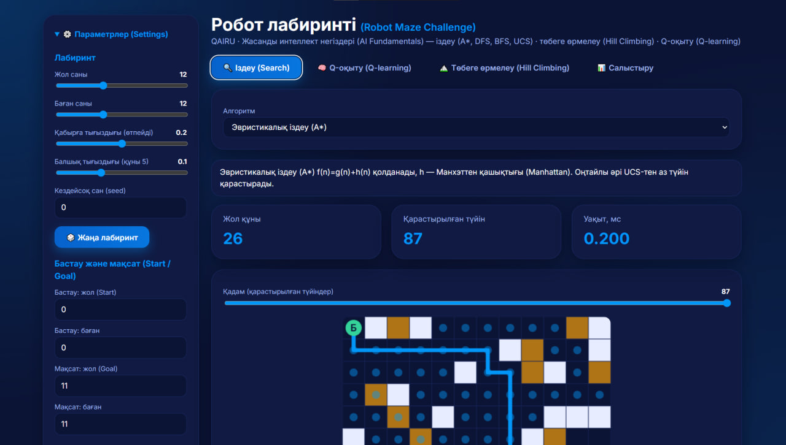
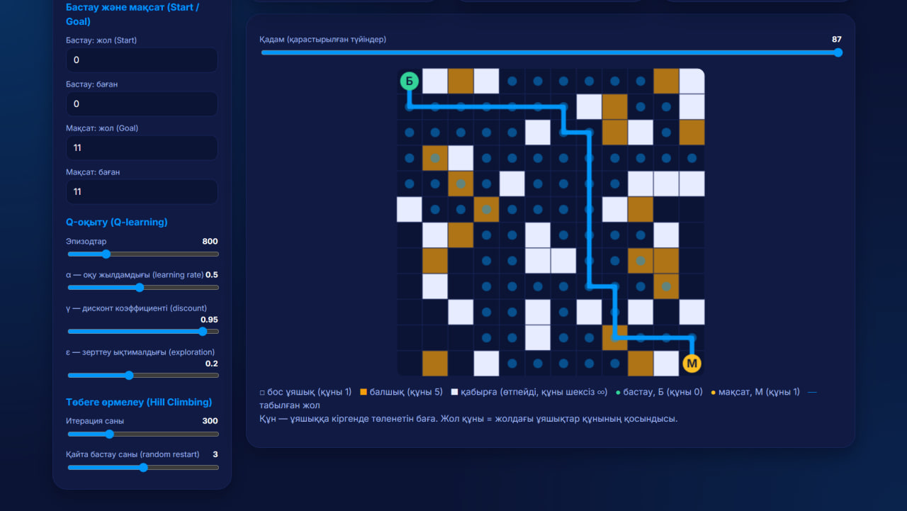
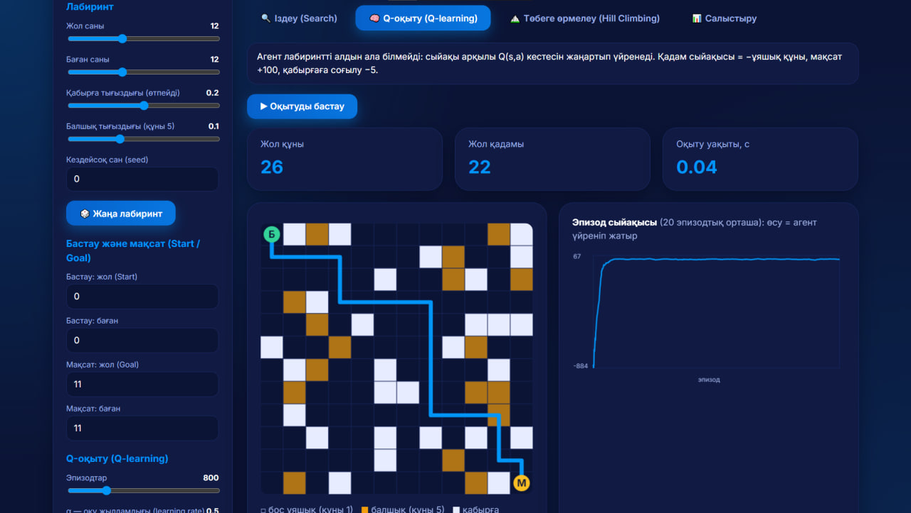
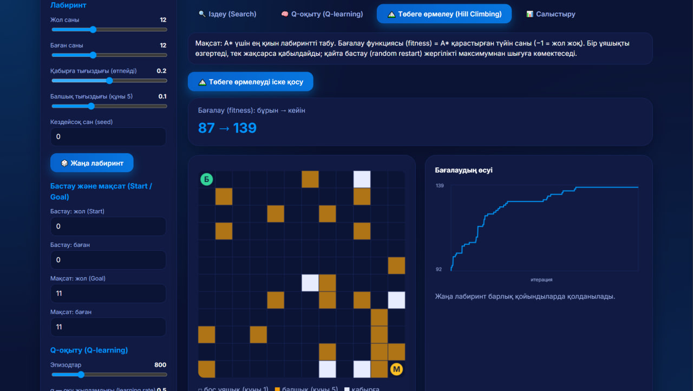
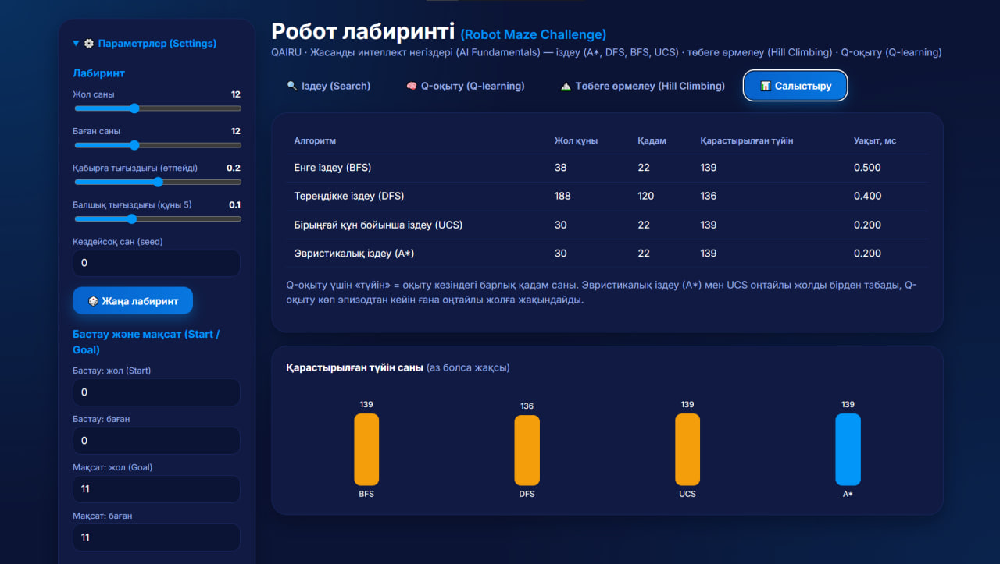

# 🤖 Робот лабиринті (Robot Maze Challenge)
**QAIRU · Жасанды интеллект негіздері (AI Fundamentals) · Final Project 2026**

## 🎯 Жобаның мақсаты
Бір ортақ интерактивті лабиринт ортасында жасанды интеллекттің үш түрлі парадигмасын — **классикалық іздеу (Search)**, **жергілікті іздеу (Local Search)** және **күшейтіп оқытуды (Reinforcement Learning)** бағдарламалық түрде іске асыру және олардың тиімділігін нақты метрикалар бойынша салыстыру.

| Апта | Силлабус тақырыбы | Іске асыру | Модуль |
|---|---|---|---|
| **2-апта** | Uninformed Search, A*, Heuristics | BFS, DFS, UCS, A* (Manhattan) | `maze_ai/search.py` |
| **3-апта** | Local Search | Hill Climbing + random restart (A* үшін ең қиын лабиринт) | `maze_ai/local_search.py` |
| **5-апта** | MDP, Reinforcement Learning | Q-learning (ε-greedy саясаты) | `maze_ai/qlearning.py` |

Орта (`maze_ai/maze.py`) үш түрлі ұяшықтан тұрады: **бос ұяшық** (құны `1`), **балшық** (құны `5`), **қабырға** (өтпейді, құны `∞`).

---

## 🏗️ Жүйе архитектурасы
```text
├── app.py                   # Streamlit веб-интерфейсі және визуализация
├── index.html               # Браузердегі дербес веб-нұсқасы
├── maze_ai/
│   ├── maze.py              # Лабиринт генерациясы, құндар, validate()
│   ├── search.py            # BFS, DFS, UCS, A* алгоритмдері
│   ├── local_search.py      # Hill Climbing + random restart, fitness()
│   └── qlearning.py         # QLearningAgent (train, greedy_path)
├── tests/                   # Pytest автоматты тесттері
├── requirements.txt         # Жоба тәуелділіктері
├── pytest.ini               # Pytest баптаулары
├── LICENSE                  # Лицензия
└── .gitignore               # Git ерекшеліктері
```

---

## 🚀 Орнату және іске қосу
1. Репозиторийді клондап, жоба бумасына кіріңіз:
```bash
git clone [https://github.com/nurshat-sudo/robot-maze-challenge.git](https://github.com/nurshat-sudo/robot-maze-challenge.git)
cd robot-maze-challenge
```
2. Қажетті кітапханаларды орнатыңыз:
```bash
pip install -r requirements.txt
```
3. Streamlit қосымшасын іске қосыңыз:
```bash
streamlit run app.py
```
4. Автоматты тесттерді тексеріңіз:
```bash
python -m pytest
```

---

## 🧪 Тестілеу нәтижелері
`tests/` бумасында келесі тексерулер қамтылған:
- **Іздеу алгоритмдері:** бос тор, жабық лабиринт, балшықты жағдай, `A* <= UCS` түйін саны.
- **Q-learning:** қабырғаға соғылу айыппұлы (`-5`), оқытудан кейін мақсатқа жету.
- **Hill Climbing:** `fitness` мәнінің кемімеуі және лабиринттің шешілетін күйде сақталуы.

---

## ⚙️ Алгоритмдер (қысқаша)
- **A\*:** кіріс — лабиринт; шығыс — оңтайлы жол, қарастырылған түйіндер; метрика — құн, түйін саны, уақыт (мс). Шектеу: тек Manhattan эвристикасы.
- **Hill Climbing:** кіріс — бастапқы лабиринт; шығыс — fitness жоғары лабиринт; метрика — fitness өсуі. Шектеу: жергілікті максимумға тұрып қалуы мүмкін (random restart жеңілдетеді).
- **Q-learning:** кіріс — орта, α/γ/ε, эпизод саны; шығыс — Q-кесте мен саясат; метрика — 20 эпизодтық орташа сыйақы қисығы, жол құнын A*-пен салыстыру. Шектеу: көп эпизод керек, ортаны өзгертсе қайта оқиды.

---

## 👥 Команда және үлес (Team Contribution)
- **Қойшыбай Нұршат** — `maze_ai/maze.py`, `maze_ai/search.py`, `tests/` (лабиринт ортасы, валидация, BFS/DFS/UCS/A* алгоритмдері, pytest тесттері).
- **Омарбек Алмаз** — `maze_ai/qlearning.py`, `maze_ai/local_search.py`, `app.py` (Q-learning, Hill Climbing, Streamlit интерфейсі және визуализация).

## 🤖 AI Usage Declaration
Жобаны әзірлеу барысында **Claude (Anthropic)** тілдік моделі техникалық көмекші ретінде (Streamlit CSS стилдері, кодты модульдерге бөлу, тест шаблондары және құжаттама рәсімдеу) қолданылды. Барлық код бөліктерін топ мүшелері толық тексеріп, жергілікті ортада іске қосты, параметрлерін баптады және `pytest` тесттерінен өткізді.

## 🖼️ Қосымша скриншоттары





